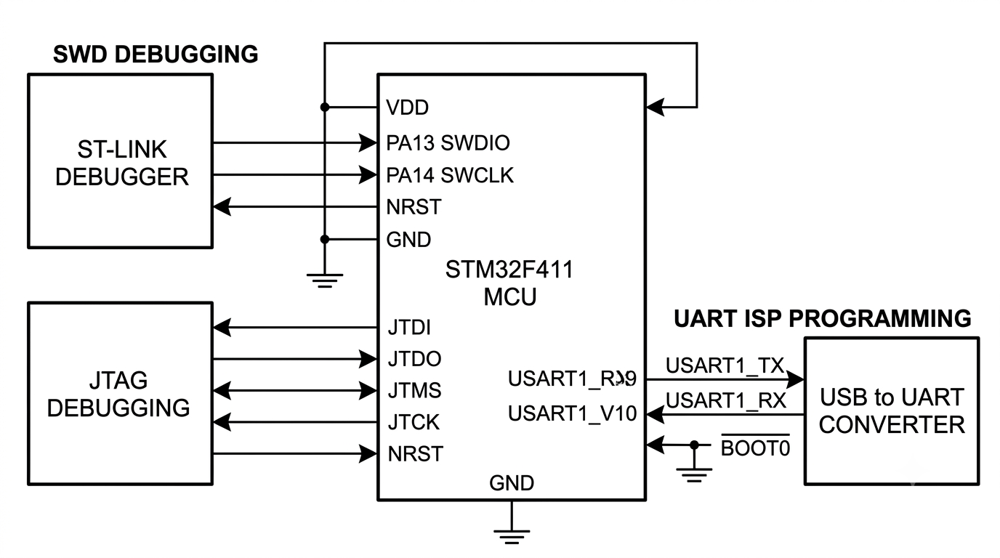

# STM32F411 프로그래밍 방식 핀 사용 및 장비 매칭 가이드

> STM32F411의 JTAG/SWD 및 Serial Programming(UART ISP) 방식에 따른 핀 사용 방법, 다운로드 장비 매칭, 핀 재사용 방법을 정리한 문서

---




## 1. 개요

STM32F411에 펌웨어를 다운로드(플래싱)하는 대표적인 방법은 다음과 같다.

| 방식 | 통신 핀 수 | 주요 용도 | 필요 장비 |
|------|-----------|----------|----------|
| **SWD** (Serial Wire Debug) | 2핀 | 디버깅 + 프로그래밍 | ST-LINK, J-Link |
| **JTAG** | 5핀 | 디버깅 + 프로그래밍 | ST-LINK, J-Link |
| **Serial Programming** (UART ISP) | 2핀 | 프로그래밍 전용 | USB-to-UART (CP2102, FT232, CH340 등) |

---

## 2. JTAG / SWD 방식 (디버깅 및 프로그래밍)

### 2.1 사용 핀

#### SWD 방식 (가장 많이 사용)

| 핀 | 기능 | 설명 |
|----|------|------|
| **PA13** | JTMS / **SWDIO** | 데이터 입출력 (Serial Wire Data Input/Output) |
| **PA14** | JTCK / **SWCLK** | 클럭 신호 (Serial Wire Clock) |

#### JTAG 방식 (추가 핀 필요)

| 핀 | 기능 | 설명 |
|----|------|------|
| PA13 | JTMS / SWDIO | 데이터 라인 |
| PA14 | JTCK / SWCLK | 클럭 라인 |
| **PA15** | JTDI | 데이터 입력 |
| **PB3** | JTDO / SWO | 데이터 출력 / Serial Wire Output |
| **PB4** | NJTRST | JTAG 리셋 (Active Low) |

#### 선택적 추가 핀

| 핀 | 기능 | 설명 |
|----|------|------|
| **PB3** | **SWO** (Serial Wire Output) | 실시간 디버깅 메시지 출력 등 추적(Trace) 기능 사용 시 연결 |

#### 전원 핀

| 핀 | 설명 |
|----|------|
| **VDD** | 전원 (3.3V) |
| **GND** | 그라운드 |

> **SWD vs JTAG**: JTAG은 기본적으로 5개의 핀을 사용하지만, SWD는 클럭과 데이터 2개의 핀(SWCLK, SWDIO)만으로 디버깅과 프로그래밍이 가능하여 핀 부족 문제를 해결할 수 있어 STM32 개발 시 가장 표준적으로 사용된다.

### 2.2 다운로드 장비

#### ST-LINK (V2 또는 V3 시리즈)
- STMicroelectronics사에서 제공하는 공식 디버거
- STM32 개발에 가장 호환성이 좋음
- V3는 더 빠른 전송 속도와 추가 기능 지원

#### J-Link (SEGGER)
- 성능이 뛰어나고 상용 제품 개발에 널리 쓰이는 범용 디버거
- SWD 핀맵에 맞춰 동일하게 연결하여 사용 가능

### 2.3 SWD 핀 연결 요약 표

| SWD 신호 | STM32F411 핀 | ST-LINK / J-Link 장비 측 핀 | 설명 |
|----------|-------------|---------------------------|------|
| SWDIO | PA13 | SWDIO | 데이터 라인 |
| SWCLK | PA14 | SWCLK | 클럭 라인 |
| SWO (선택) | PB3 | SWO / TRACE | 실시간 트레이스/출력 |
| GND | GND | GND | 공통 접지 |
| 3.3V | VDD | VCC / 3V3 | 타겟 전원 공급 (또는 전원 감지) |

### 2.4 핀 연결 예시 (SWD)

```
┌──────────────┐                    ┌──────────────────┐
│   ST-LINK    │                    │   STM32F411      │
│              │                    │                  │
│  SWDIO  ─────┼────────────────────┼── PA13 (SWDIO)   │
│  SWCLK  ─────┼────────────────────┼── PA14 (SWCLK)   │
│  SWO    ─────┼────────────────────┼── PB3  (SWO)     │
│  GND    ─────┼────────────────────┼── GND            │
│  3V3    ─────┼────────────────────┼── VDD            │
└──────────────┘                    └──────────────────┘
```

---

## 3. Serial Programming 방식 (UART ISP 부트로더)

### 3.1 개요

STM32F411 칩 내부의 **시스템 메모리(System Memory)**에는 제조사(STMicroelectronics)에서 미리 구워 넣은 하드웨어 부트로더가 내장되어 있어, **별도의 디버거(ST-LINK 등) 없이도** UART 인터페이스를 통해 펌웨어를 다운로드할 수 있다.

### 3.2 사용 핀 (USART1 기준)

| 핀 | 기능 | 연결 대상 |
|----|------|----------|
| **PA9** | USART1_TX | USB-to-UART 장비의 **RX** |
| **PA10** | USART1_RX | USB-to-UART 장비의 **TX** |
| GND | 그라운드 | USB-to-UART 장비의 GND |
| VDD | 전원 (3.3V) | USB-to-UART 장비의 3.3V |

> **주의**: TX↔RX, RX↔TX 교차 연결이 필요하다. (STM32의 TX는 장비의 RX로, STM32의 RX는 장비의 TX로 연결)

### 3.3 ISP 모드 진입 방법

```
1. BOOT0 핀을 HIGH (VDD) 상태로 설정
2. MCU를 리셋(또는 전원 재인가) → 부트로더 모드 진입
3. UART를 통해 펌웨어 다운로드
4. 다운로드 완료 후 BOOT0 핀을 LOW (GND)로 변경
5. MCU 리셋 → 일반 사용자 플래시 메모리에서 코드 실행
```

#### BOOT0 핀 설정

| 모드 | BOOT0 상태 | 설명 |
|------|-----------|------|
| ISP 부트로더 모드 | **HIGH (VDD)** | UART로 펌웨어 다운로드 가능 |
| 일반 플래시 부팅 | **LOW (GND)** | 사용자 펌웨어 실행 |

### 3.4 다운로드 장비

| 장비 종류 | 예시 | 비고 |
|----------|------|------|
| USB-to-UART 변환기 | **CP2102**, **FT232**, **CH340** 등 | 저렴하고容易 구할 수 있음 |

### 3.5 사용 프로그램

- **STM32CubeProgrammer**: STMicroelectronics에서 제공하는 공식 툴
  - UART를 통한 펌웨어 쓰기 및 읽기가 편리
  - BOOT0 진입 후 COM 포트를 선택하여 플래싱

### 3.6 핀 연결 예시 (UART ISP)

```
┌──────────────────┐                    ┌──────────────────┐
│  USB-to-UART     │                    │   STM32F411      │
│  (CP2102 등)     │                    │                  │
│  TX   ───────────┼────────────────────┼── PA10 (USART1_RX)│
│  RX   ───────────┼────────────────────┼── PA9  (USART1_TX)│
│  GND  ───────────┼────────────────────┼── GND            │
│  3.3V ───────────┼────────────────────┼── VDD            │
└──────────────────┘                    │                  │
                                        │  BOOT0 ── VDD    │ (HIGH)
                                        └──────────────────┘
```

---

## 4. 핀 재사용 가능 여부

**결론**: JTAG/SWD 디버깅 핀과 UART ISP 핀 모두 **플래싱(프로그래밍)이 끝난 후 일반 GPIO나 주변장치 기능 핀(AF, Alternate Function)으로 자유롭게 재사용할 수 있다.**

### 4.1 JTAG / SWD 핀 재사용 (PA13, PA14, PA15, PB3, PB4)

| 항목 | 내용 |
|------|------|
| **가능 여부** | ✅ 가능 |
| **설명** | MCU가 부팅되어 사용자 펌웨어가 실행되면, 코드가 이 핀들을 일반 GPIO(입력, 출력)나 다른 기능(SPI, 타이머 등)으로 설정하여 사용할 수 있음 |

**주의할 점:**
- 이 핀들을 일반 용도로 바꾸어 사용 중이거나 핀 기능이 변경된 상태라면, 이후에 ST-LINK로 디버깅이나 재플래싱을 시도할 때 **연결이 끊기거나 칩 인식(Connect)에 실패**할 수 있음
- 이 경우 대처 방법:
  - **Connect Under Reset**: 코드가 실행되기 전에 리셋 버튼을 누른 상태에서 ST-LINK의 플래싱 명령을 실행
  - **부트로더 모드 활용**: BOOT0 HIGH로 설정하여 ISP 모드로 진입 후 플래싱
  - **.option bytes**에서 **NRST_STDBY/STANDBY** 또는 **nBOOT_SEL** 설정을 통해 복구 가능

### 4.2 Serial Programming / UART ISP 핀 재사용 (PA9, PA10)

| 항목 | 내용 |
|------|------|
| **가능 여부** | ✅ 가능 |
| **설명** | PA9(USART1_TX)와 PA10(USART1_RX)은 펌웨어를 다운로드할 때(UART 부트로더 상태)만 ISP 통신용으로 사용되고, 다운로드가 끝나고 일반 모드로 부팅되면 완전히 일반 GPIO나 다른 통신 기능(일반 USART, 타이머, GPIO 등)으로 자유롭게 쓸 수 있음 |

**주의할 점:**
- 다운로드가 완료된 후 **BOOT0 핀을 다시 LOW(GND)로 내려** 정상 부팅 모드로 만들어야 일반 사용자 프로그램이 실행됨
- 이때 PA9, PA10 핀이 코드 내 설정에 따라 원하는 기능으로 동작하게 됨

---

## 5. 방법 비교 요약

| 항목 | SWD | JTAG | UART ISP |
|------|-----|------|----------|
| **필요 핀 수** | 2핀 (SWDIO, SWCLK) | 5핀 | 2핀 (TX, RX) |
| **디버깅** | ✅ 가능 | ✅ 가능 | ❌ 불가 (플래싱 전용) |
| **플래싱** | ✅ 가능 | ✅ 가능 | ✅ 가능 |
| **추가 조건** | 없음 | 없음 | BOOT0 HIGH 필요 |
| **대표 장비** | ST-LINK, J-Link | ST-LINK, J-Link | CP2102, FT232, CH340 |
| **속도** | 빠름 | 보통 | 느림 |
| **일반적인 용도** | 개발/디버깅 시 기본 | 레거시 시스템 | 디버거 없이 플래싱 |

---

## 6. 참고사항

- STM32F411의 SWD 핀(PA13, PA14)은 **리셋 후 기본 상태**에서 SWD 기능으로 활성화된다
- STM32CubeProgrammer, Keil, IAR 등 주요 IDE에서 모두 SWD를 기본 디버깅 인터페이스로 지원
- UART ISP 사용 시 STM32CubeProgrammer의 "UART" 연결 타입을 선택하여 COM 포트를 지정
- BOOT0 핀은 보드 설계 시 **스위치 또는 점퍼**로 HIGH/LOW를 전환할 수 있게 구성하는 것이 일반적
