# 호환성

* https://siliconpr0n.org/

---

## STM32F103VGT6 : Weekend die-shot

   * STM32F103VGT6 is one of the largest STMicroelectronics's Cortex-M3 microcontrollers.
   * 1Mb of flash and 96kb of SRAM consumes most of it's enormous 5339x5188 µm die.

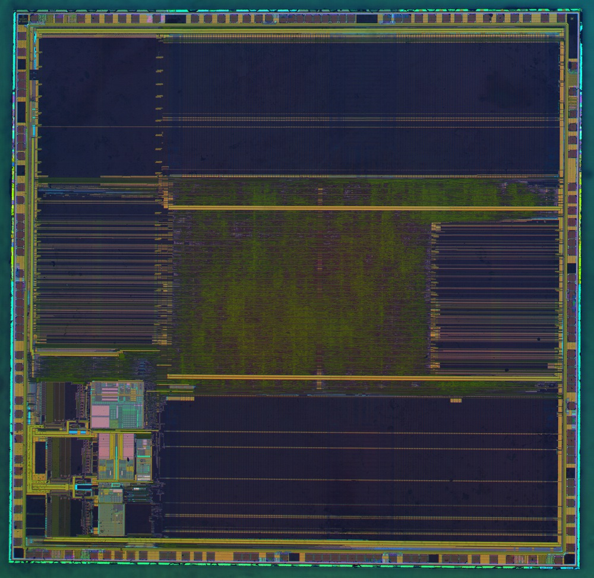

180nm SRAM scratches the limits of optical microscopy:

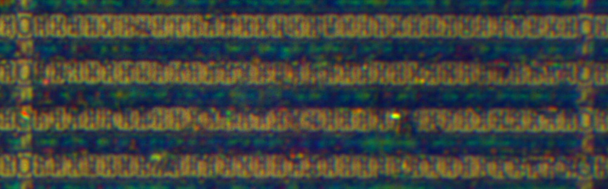

die shot

  
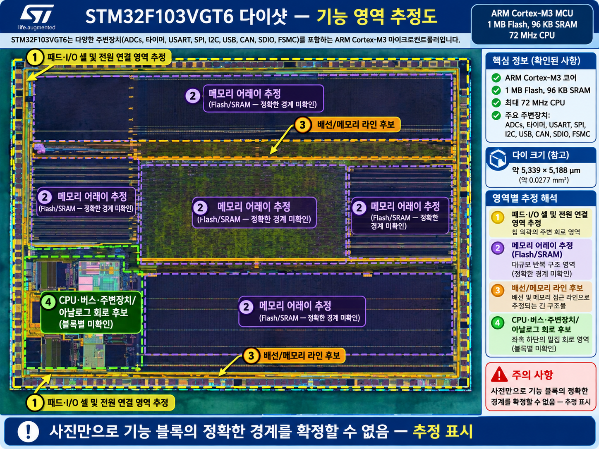

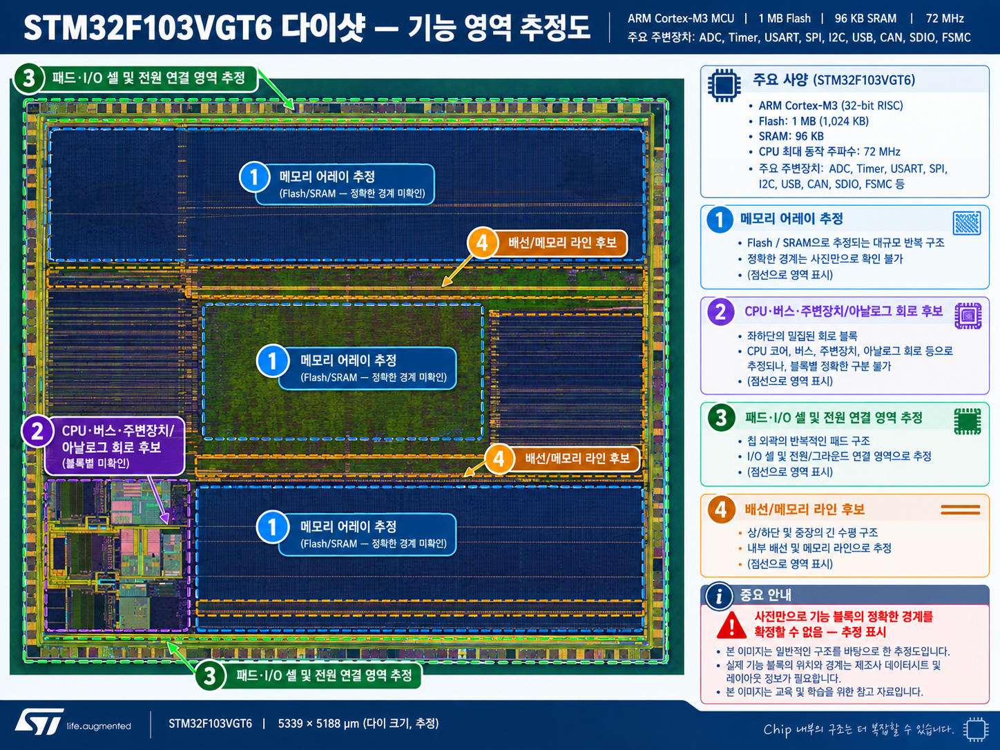

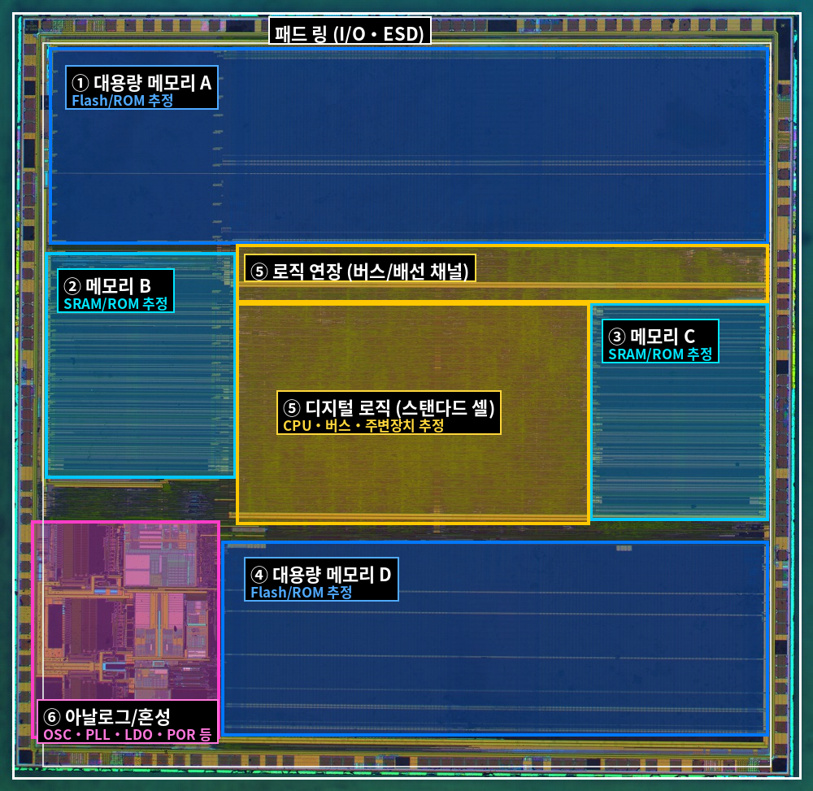

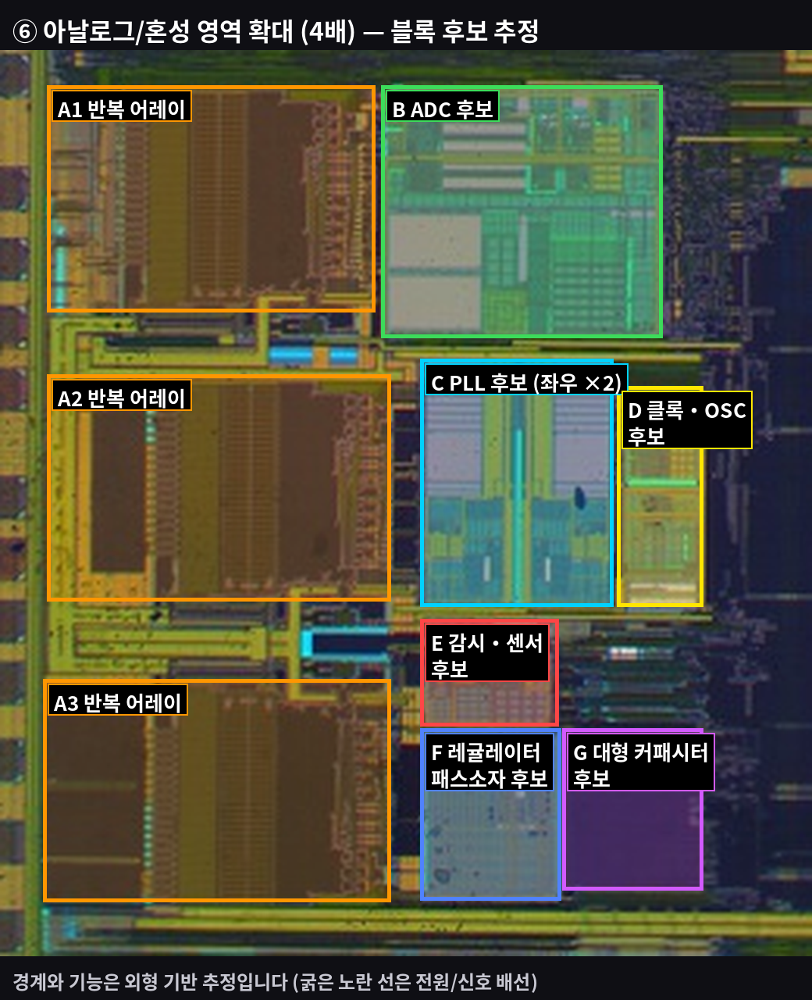

| 표시	| 후보	| 판단 근거	| 신뢰도 | 
|:------:||:------:||:------:||:------:|
| B	| ADC	| 규칙적인 초록 격자(커패시터 어레이로 보임)와 분홍 대형 사각형이 섞여 있고, 상단에 비교기/로직으로 보이는 작은 셀이 있습니다.	| 중간 | 
| C	| PLL (PLL1/PLL2)	| 좌우 대칭인 같은 구조가 둘 있고, 분홍 대형 사각형은 루프 필터 R/C로 보입니다. 사양에 PLL이 2개라는 점과도 맞습니다.	| 낮음~중간 | 
| D	| 클록/오실레이터	| C 바로 옆의 작은 블록으로, 내부 RC나 XTAL 오실레이터 규모에 맞습니다.	| 낮음 | 
| E	| 감시·센서	| 작고 격자형이며 전원 블록 옆에 있습니다. POR/BOR/PVD나 온도센서 규모입니다.	| 낮음 | 
| F	| 레귤레이터 패스 소자	| 균일하고 미세한 큰 배열입니다. 대전류를 내는 넓은 트랜지스터 어레이의 모습입니다.	| 낮음~중간 | 
| G	| 대형 커패시터	| 내부가 비어 보이는 어두운 큰 사각형으로, 보상/디커플링용 MOS 커패시터 후보입니다.	| 낮음 | 
| A1~A3	| 반복 어레이 (미확정)	| 같은 구조가 세로로 3개 반복되고 굵은 배선으로 묶여 있습니다.	| 낮음 | 

---

### The Engineering that Runs the Digital World 🛠️⚙️💻 How do CPUs Work?

https://youtu.be/16zrEPOsIcI

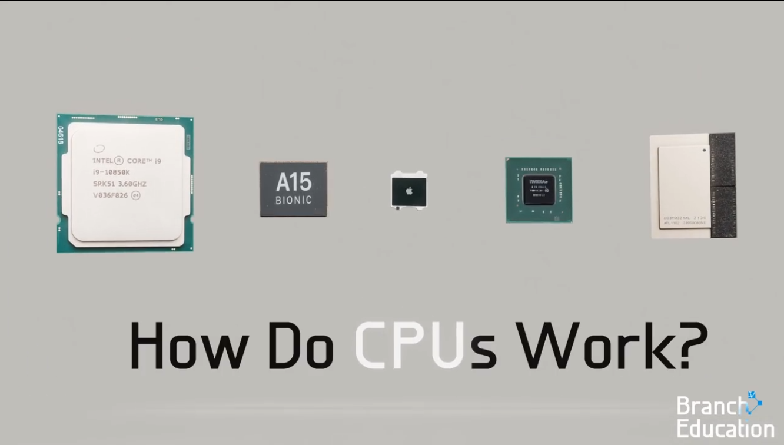

---

## STM32F103xx

* STM32F103xx는 모든 제품군이 핀(Pin-to-Pin),
  * 소프트웨어, 그리고 기능면에서 완벽하게 호환되는 완전한 패밀리입니다. 

* 레퍼런스 매뉴얼에서
  * STM32F103x4 및 STM32F103x6은 저밀도(Low-density) 디바이스로,
  * STM32F103x8 및 STM32F103xB는 중밀도(Medium-density) 디바이스로,
  * STM32F103xC, STM32F103xD 및 STM32F103xE는 고밀도(High-density) 디바이스로 분류됩니다.

* 저밀도 및 고밀도 디바이스는 STM32F103x8/B 디바이스의 확장형이며,
  * 각각 STM32F103x4/6 및 STM32F103xC/D/E 데이터시트에 명시되어 있습니다. 

* 저밀도 디바이스는 더 적은 플래시 메모리 및 RAM 용량,
  * 그리고 더 적은 수의 타이머와 주변장치를 제공합니다. 

* 고밀도 디바이스는 더 큰 플래시 메모리 및 RAM 용량을 가지며,
  * STM32F103xx 패밀리의 다른 멤버들과 완벽하게 호환되면서도 SDIO, FSMC, I2S, DAC와 같은 추가적인 주변장치들을 탑재하고 있습니다.

* STM32F103x4, STM32F103x6, STM32F103xC, STM32F103xD 및
  * STM32F103xE는 STM32F103x8/B 중밀도 디바이스의 드롭인(drop-in) 대체품으로 사용할 수 있어, 

* 사용자가 다양한 메모리 밀도를 시험해 볼 수 있도록 하고 개발 주기 동안 더 큰 설계 자유도를 제공합니다.

* 또한, STM32F103xx 퍼포먼스 라인 패밀리는 기존의 모든 STM32F101xx 액세스 라인 및
  * STM32F102xx USB 액세 라인 디바이스와 완벽하게 호환됩니다.

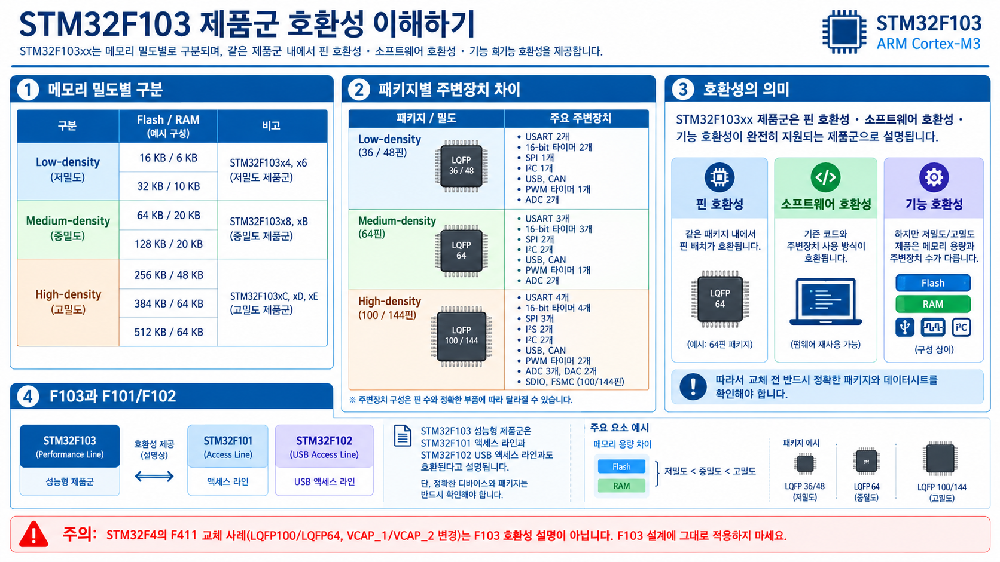

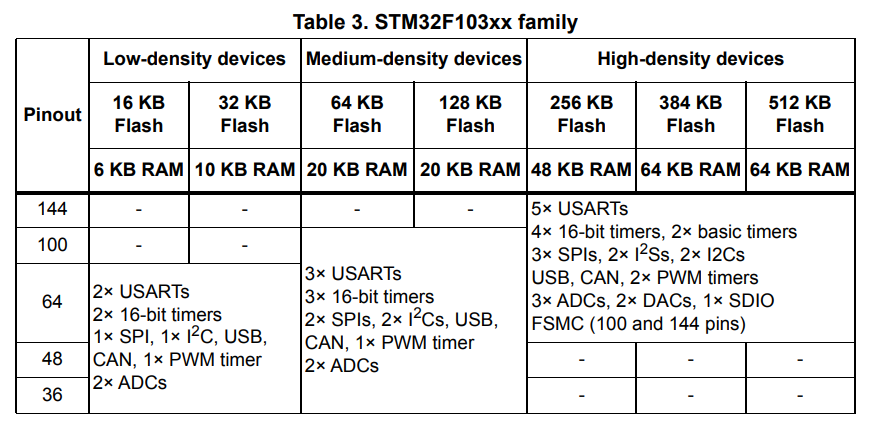

---

## STM32F411xx

* STM32F411xC/xE는 STM32F4 시리즈(STM32F42x, STM32F401, STM32F43x, STM32F41x, STM32F405, STM32F407)와 소프트웨어 및 기능 면에서 완벽하게 호환됩니다. 

* STM32F411xC/xE는 다른 STM32F4 제품들의 드롭인(drop-in) 대체품으로 사용할 수 있지만, PCB 기판에 약간의 변경 사항이 필요합니다.

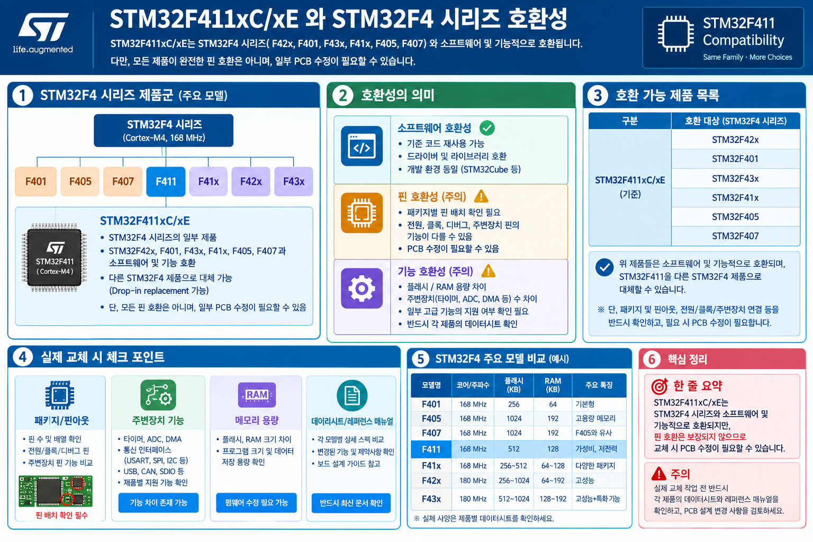

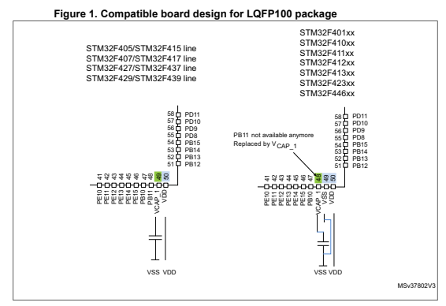

### Figure 1. LQFP100 패키지 호환 보드 디자인 

* 대상 칩군 비교:
  * 왼쪽: STM32F405/F415, STM32F407/F417, STM32F427/F437, STM32F429/F439 라인
  * 오른쪽: STM32F401xx, STM32F410xx, STM32F411xx, STM32F412xx, STM32F413xx, STM32F423xx, STM32F446xx 라인
* 핵심 변경 사항:
  * 오른쪽 라인에서는 기존의 PB11 핀이 더 이상 제공되지 않으며, 해당 핀이 내부 전원 안정화용 커패시터 연결 핀인 VCAP_1로 대체되었습니다.
  * 따라서 오른쪽 계열 칩을 사용할 때는 48번 핀(VCAP_1)에 외부 디커플링 커패시터(VSS 연결)를 구성하도록 PCB 배선을 수정해야 함을 보여줍니다.   

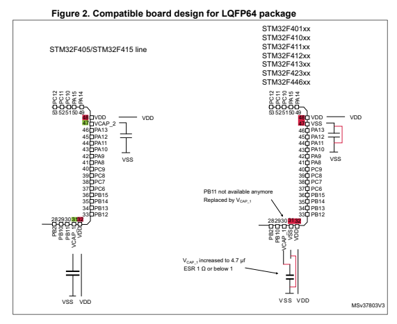

### Figure 2. LQFP64 패키지 호환 보드 디자인

* 대상 칩군 비교:
  * 왼쪽: STM32F405/F415 라인
  * 오른쪽: STM32F401xx, STM32F410xx, STM32F411xx, STM32F412xx, STM32F413xx, STM32F423xx, STM32F446xx 라인

* 핵심 변경 사항:
  * LQFP64 패키지에서도 마찬가지로 PB11 핀이 사라지고 VCAP_1 핀으로 변경되었습니다 (31번 핀).
  * 이에 따라 VCAP_1에 연결되는 커패시터 용량이 4.7 µF(ESR 1 Ω 이하)로 증가해야 한다는 조건이 명시되어 있습니다.
  * 또한 상단 47번 핀(VCAP_2 또는 VSS/VDD 전원 라인) 주변의 전원 및 접지(VSS/VDD) 배선 구조가 칩 종류에 따라 달라지므로,
  * 두 칩을 모두 호환하여 쓸 수 있도록 파란색 및 빨간색 선으로 표시된 전원/접지 배선 라인을 공용으로 레이아웃해야 함을 나타냅니다.   

### 요약

  * 이 그림들은 서로 다른 STM32F4 칩 간에 핀투핀(Pin-to-Pin) 호환성을 유지하면서 PCB를 공용으로 설계할 때,
  * 사라진 핀(PB11 등)과 새로 추가되거나 변경된 전원/커패시터 핀(VCAP_1) 간의 배선 차이를 어떻게 처리해야 하는지 가이드라인을 제공합니다.   

---
## STM32 MCU 설계 영역 분류
---

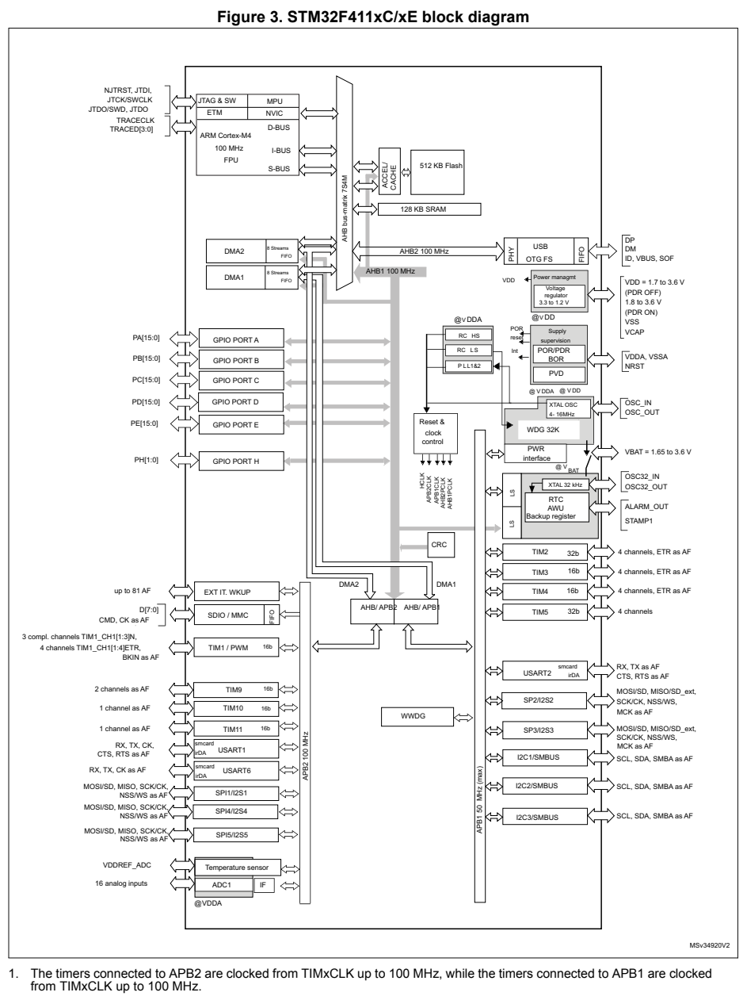

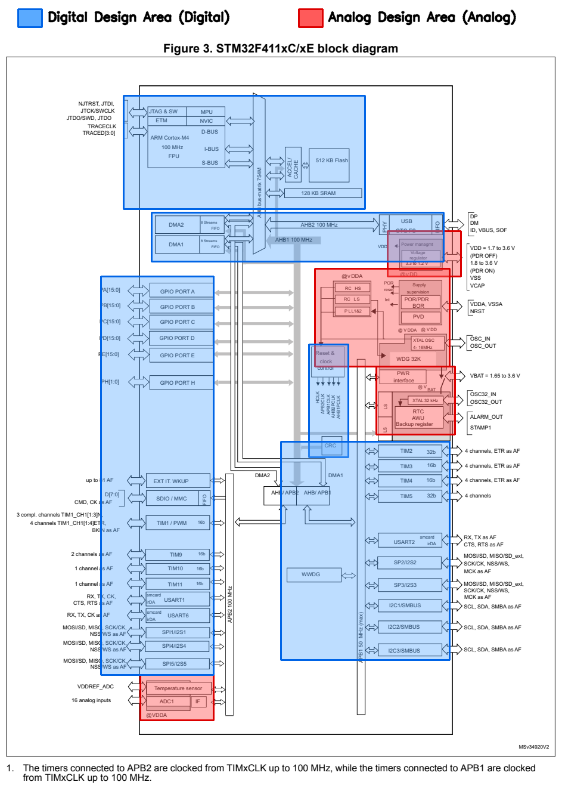

https://youtu.be/dX9CGRZwD-w

https://youtu.be/_Pqfjer8-O4

https://youtu.be/h9Z4oGN89MU

### 1. 디지털 설계 영역 (Digital Design Domain)

논리 합성, 레지스터 전송 레벨(RTL) 설계, 버스 프로토콜, 타이밍 및 제어 로직 등이 적용되는 영역입니다.

#### 프로세서 및 코어 서브시스템

| 블록 | 설명 |
|------|------|
| ARM Cortex-M4 코어 | 100 MHz, FPU, MPU, NVIC, ETM, JTAG & SW |

#### 메모리 및 인터페이스

| 블록 | 설명 |
|------|------|
| Flash | 512 KB |
| SRAM | 128 KB |
| ACCEL / CACHE | 가속기 및 캐시 |
| AHB / APB 버스 매트릭스 및 브리지 | AHB1, AHB2, APB1, APB2 |

#### 디지털 주변장치 (Peripherals)

| 분류 | 블록 |
|------|------|
| DMA | DMA1, DMA2 (Direct Memory Access) |
| GPIO | PORT A, B, C, D, E, H |
| 타이머 | TIM1/PWM, TIM2, TIM3, TIM4, TIM5, TIM9, TIM10, TIM11 |
| 통신 인터페이스 | USB OTG FS (PHY 포함), USART1/2/6, SPI1/SPI2/SPI3/SPI4/SPI5, I2C1/I2C2/I2C3, SDIO/MMC |
| 시스템 및 제어 로직 | CRC, WWDG, IWDG, EXTI (External Interrupt) |

---

### 2. 아날로그 설계 영역 (Analog Design Domain)

트랜지스터 레벨의 회로 설계, 노이즈 및 신호 무결성 고려, 전력 관리, 클록 생성 등을 다루는 영역입니다.

#### 클록 및 리셋 (Clock & Reset / RC Oscillator)

| 블록 | 설명 |
|------|------|
| RC HS | High-Speed 내부 RC 오실레이터 |
| RC LS | Low-Speed 내부 RC 오실레이터 |
| PLL1 & PLL2 | 위상 동기 회로 |
| XTAL OSC | 외부 고속 크리스탈 오실레이터 (4~16 MHz) |
| XTAL 32 kHz | 저속 실시간 클록 오실레이터 |

#### 전력 관리 및 감시 (Power Management & Supervision)

| 블록 | 설명 |
|------|------|
| Voltage Regulator | 전압 레귤레이터 (3.3V → 1.2V) |
| POR / PDR / BOR | Power-On Reset / Power-Down Reset / Brown-Out Reset 회로 |
| PVD | 프로그래머블 전압 검출기 (Programmable Voltage Detector) |
| PWR Interface | 전력 관리 인터페이스 |
| Backup Register / RTC | 백업 레지스터 및 실시간 시계 |

#### 아날로그 인터페이스 및 센서

| 블록 | 설명 |
|------|------|
| ADC1 & IF | Analog-to-Digital Converter 및 인터페이스 |
| Temperature Sensor | 온도 센서 |

---
## MCU 설계 영역 분류 (STM32F1 계열)
---

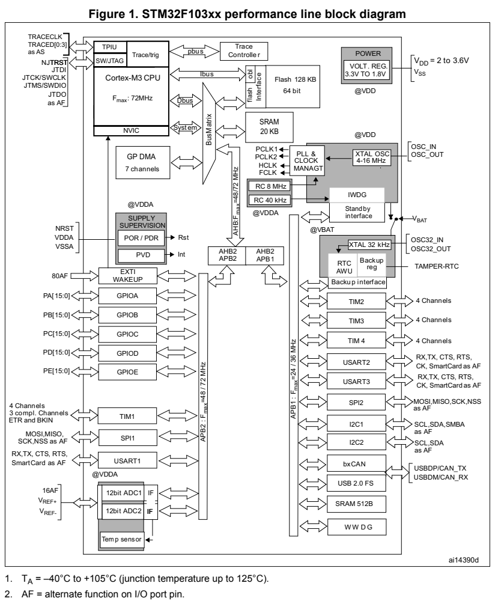

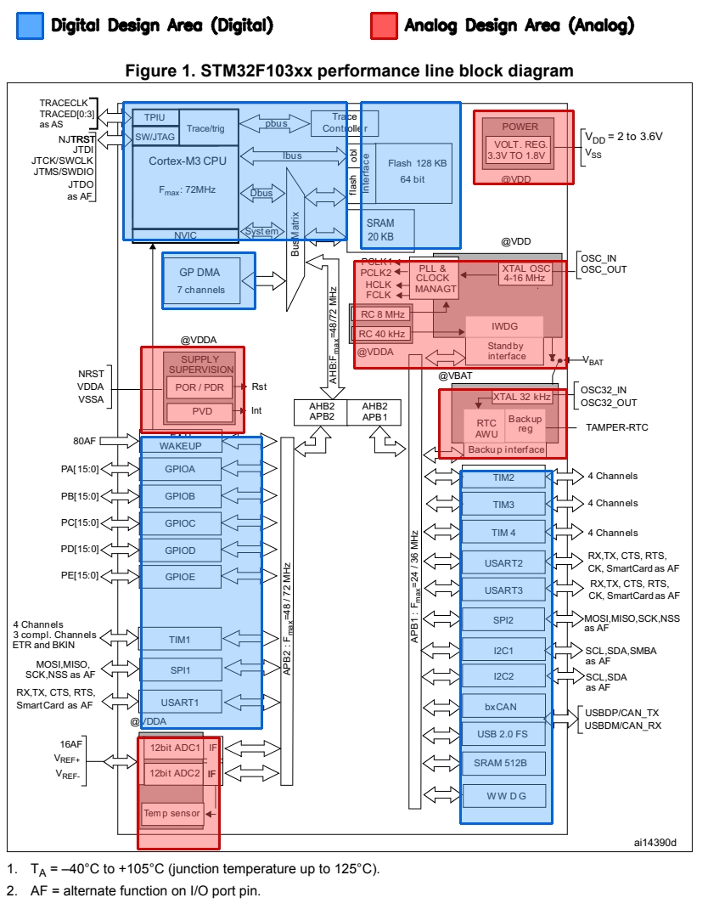

### 1. 디지털 설계 영역 (Digital Design Domain)

논리 합성, 레지스터 전송 레벨(RTL) 설계, 버스 프로토콜, 타이밍 및 제어 로직 등이 적용되는 영역입니다.

#### 프로세서 및 코어 서브시스템

| 블록 | 설명 |
|------|------|
| ARM Cortex-M3 CPU | 72 MHz, NVIC, TPIU, SW/JTAG, Trace Controller |

#### 메모리 및 인터페이스

| 블록 | 설명 |
|------|------|
| Flash | 128 KB (64-bit) |
| SRAM | 20 KB (배치된 512B SRAM 포함) |
| Bus Matrix | 버스 매트릭스 |
| Flash Interface | 플래시 인터페이스 |

#### 디지털 주변장치 (Peripherals)

| 분류 | 블록 |
|------|------|
| DMA | GP DMA (7 channels) |
| GPIO | PORT A, B, C, D, E |
| 타이머 | TIM1, TIM2, TIM3, TIM4 |
| 통신 인터페이스 | USART1, USART2, USART3, SPI1, SPI2, I2C1, I2C2, bxCAN, USB 2.0 FS |
| 시스템 및 제어 로직 | EXTI WAKEUP, WWDG, IWDG |

---

### 2. 아날로그 설계 영역 (Analog Design Domain)

트랜지스터 레벨의 회로 설계, 노이즈 및 신호 무결성 고려, 전력 관리, 클록 생성 등을 다루는 영역입니다.

#### 클록 및 리셋 (Clock & Reset / Oscillator)

| 블록 | 설명 |
|------|------|
| RC 8 MHz | 내부 고속 RC 오실레이터 |
| RC 40 kHz | 내부 저속 RC 오실레이터 |
| PLL & Clock Management | 위상 동기 회로 및 클록 관리 |
| XTAL OSC | 외부 고속 오실레이터 (4~16 MHz) |
| XTAL 32 kHz | 저속 실시간 클록 오실레이터 |

#### 전력 관리 및 감시 (Power Management & Supervision)

| 블록 | 설명 |
|------|------|
| Power Voltage Regulator | 전압 레귤레이터 (3.3V → 1.8V) |
| Supply Supervision | 공급 전압 감시 (POR / PDR, PVD) |
| Standby Interface | 대기 모드 인터페이스 |
| RTC AWU | 실시간 시계 + 자동 깨우기 유닛 |
| Backup Register | 백업 레지스터 |

#### 아날로그 인터페이스 및 센서

| 블록 | 설명 |
|------|------|
| ADC1 & ADC2 | 12bit 아날로그-디지털 변환기 및 인터페이스 |
| Temp Sensor | 온도 센서 |

---
---

# 메모리 설계의 디지털 · 아날로그 영역 분류

https://youtu.be/9kM3mnxrMMM

https://youtu.be/TfhL5kBiQVI

## 1. 플래시 메모리 (Flash Memory)

| 영역 | 분류 | 설명 |
|------|------|------|
| **메모리 셀** | Analog / Physics Domain | 플로팅 게이트(Floating Gate) 또는 차지 트랩(Charge Trap) 트랜지스터를 이용해  전자(Electron)를 가두어 문턱 전압($V_{th}$)을 변화시키는 아날로그적 물리 현상  (Fowler-Nordheim 터널링 / 핫 전자 주입) |
| | | MLC / TLC /QLC 기술은 전압 단계를 수십 개로 쪼개어 미세하게 제어  → 극도로 정밀한 아날로그 및 센싱 기술 요구 |
| **주변 회로** | Mixed-Signal / Analog Domain | **Charge Pump**:  쓰기/삭제 시 필요한 높은 전압(10V 이상) 생성을 위한 아날로그 회로 |
| | | **Sense Amplifier**:  미세한 전압 차이를 감지해 0과 1을 판별하는 아날로그 회로 |
| **컨트롤러 / 로직** | Digital Domain | ECC(에러 정정 코드), 어드레스 스위칭,  상태 머신(State Machine) 등 순수 디지털 로직 구현 |

---

## 2. SRAM (Static RAM)

| 영역 | 분류 | 설명 |
|------|------|------|
| **메모리 셀** | Digital & Analog Boundary | 6개의 트랜지스터(6T)로 구성된 디지털 래치(Latch / 플립플롭 구조).  전원 공급 동안 0과 1의 디지털 상태를 안정적으로 유지 |
| **아날로그 설계 고려사항** | Analog Design Issues | 디지털 셀로 구성되어 있으나,  고속 동작과 안정성을 위한 Custom Layout 및 Circuit Design이 매우 중요 |
| **노이즈 마진 / 비트라인 센싱** | Analog Design Issues | 읽기/쓰기 시 미세한 비트라인(Bitline) 전압 흔들림 감지 필요  → 센스 앰프의 매칭, 노이즈, 오프셋 전압 등 아날로그 특성이 성능 좌우 |
| **공정 변동성** | Analog Design Issues | 트랜지스터 미세화에 따른 특성 불일치(Mismatch) 해결을 위해  아날로그 시뮬레이션 및 레이아웃 기법 적용 (Interdigitation, Dummy Cell 등) |

---

## 3. 요약

> - 데이터 저장 단위(메모리 셀 및 센싱 영역)는 **전압 제어, 터널링, 노이즈 마진, 센스 앰프** 등의 아날로그적 물리 현상과 회로 설계가 깊게 관여합니다. 
>  
> - 블록 다이어그램상에서 메모리와 주변장치가 **디지털 영역(파란색)**으로 크게 묶여 있더라도,  
> 실제 칩 내부의 **메모리 매크로 내부와 인터페이스 아날로그 블록**에는 **아날로그 / 믹스드 신호(Mixed-Signal)** 설계 기술이 핵심적으로 녹아들어 있습니다. 

---
---

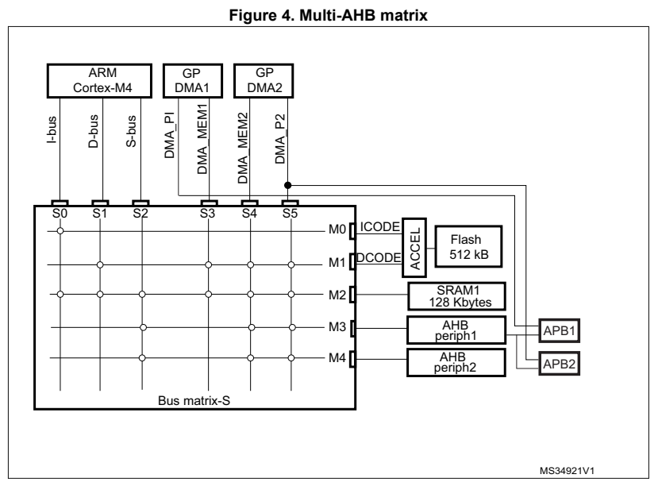

---
---

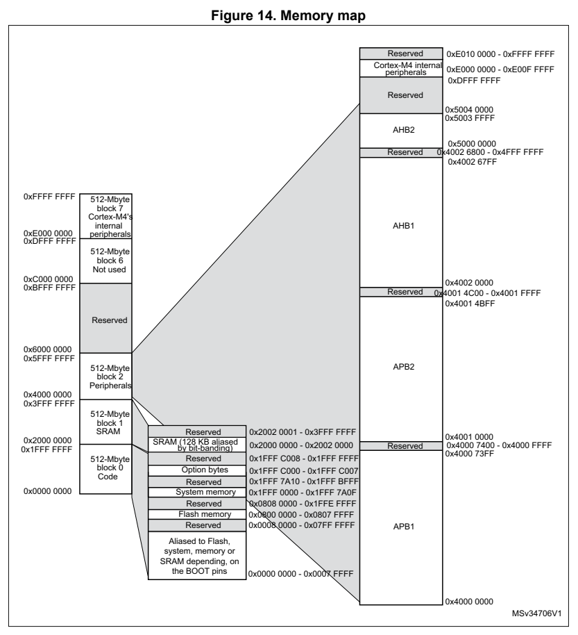

| 버스 (Bus) | 경계 주소 (Boundary Address) | 주변장치 (Peripheral) |
| :--- | :--- | :--- |
| **Cortex-M4** | `0xE010 0000 - 0xFFFF FFFF` | Reserved |
| **Cortex-M4** | `0xE000 0000 - 0xE00F FFFF` | Cortex-M4 internal peripherals |
| - | `0x5004 0000 - 0xDFFF FFFF` | Reserved |
| **AHB2** | `0x5000 0000 - 0x5003 FFFF` | USB OTG FS |
| - | `0x4002 6800 - 0x4FFF FFFF` | Reserved |
| **AHB1** | `0x4002 6400 - 0x4002 67FF` | DMA2 |
| **AHB1** | `0x4002 6000 - 0x4002 63FF` | DMA1 |
| - | `0x4002 5000 - 0x4002 5FFF` | Reserved |
| **AHB1** | `0x4002 3C00 - 0x4002 3FFF` | Flash interface register |
| **AHB1** | `0x4002 3800 - 0x4002 3BFF` | RCC |
| - | `0x4002 3400 - 0x4002 37FF` | Reserved |
| **AHB1** | `0x4002 3000 - 0x4002 33FF` | CRC |
| - | `0x4002 2000 - 0x4002 2FFF` | Reserved |
| **AHB1** | `0x4002 1C00 - 0x4002 1FFF` | GPIOH |
| - | `0x4002 1400 - 0x4002 1BFF` | Reserved |
| **AHB1** | `0x4002 1000 - 0x4002 13FF` | GPIOE |
| **AHB1** | `0x4002 0C00 - 0x4002 0FFF` | GPIOD |
| **AHB1** | `0x4002 0800 - 0x4002 0BFF` | GPIOC |
| **AHB1** | `0x4002 0400 - 0x4002 07FF` | GPIOB |
| **AHB1** | `0x4002 0000 - 0x4002 03FF` | GPIOA |
| - | `0x4001 5400 - 0x4001 FFFF` | Reserved |
| **APB2** | `0x4001 5000 - 0x4001 53FF` | SPI5 / I2S5 |
| **APB2** | `0x4001 4800 - 0x4001 4BFF` | TIM11 |
| **APB2** | `0x4001 4400 - 0x4001 47FF` | TIM10 |
| **APB2** | `0x4001 4000 - 0x4001 43FF` | TIM9 |
| **APB2** | `0x4001 3C00 - 0x4001 3FFF` | EXTI |
| **APB2** | `0x4001 3800 - 0x4001 3BFF` | SYSCFG |
| **APB2** | `0x4001 3400 - 0x4001 37FF` | SPI4 / I2S4 |
| **APB2** | `0x4001 3000 - 0x4001 33FF` | SPI1 / I2S1 |
| **APB2** | `0x4001 2C00 - 0x4001 2FFF` | SDIO |
| - | `0x4001 2400 - 0x4001 2BFF` | Reserved |
| **APB2** | `0x4001 2000 - 0x4001 23FF` | ADC1 |
| - | `0x4001 1800 - 0x4001 1FFF` | Reserved |
| **APB2** | `0x4001 1400 - 0x4001 17FF` | USART6 |
| **APB2** | `0x4001 1000 - 0x4001 13FF` | USART1 |
| - | `0x4001 0400 - 0x4001 0FFF` | Reserved |
| **APB2** | `0x4001 0000 - 0x4001 03FF` | TIM1 |
| - | `0x4000 7400 - 0x4000 FFFF` | Reserved |
| **APB1** | `0x4000 7000 - 0x4000 73FF` | PWR |
| - | `0x4000 6000 - 0x4000 6FFF` | Reserved |
| **APB1** | `0x4000 5C00 - 0x4000 5FFF` | I2C3 |
| **APB1** | `0x4000 5800 - 0x4000 5BFF` | I2C2 |
| **APB1** | `0x4000 5400 - 0x4000 57FF` | I2C1 |
| - | `0x4000 4800 - 0x4000 53FF` | Reserved |
| **APB1** | `0x4000 4400 - 0x4000 47FF` | USART2 |
| **APB1** | `0x4000 4000 - 0x4000 43FF` | I2S3ext |
| **APB1** | `0x4000 3C00 - 0x4000 3FFF` | SPI3 / I2S3 |
| **APB1** | `0x4000 3800 - 0x4000 3BFF` | SPI2 / I2S2 |
| **APB1** | `0x4000 3400 - 0x4000 37FF` | I2S2ext |
| **APB1** | `0x4000 3000 - 0x4000 33FF` | IWDG |
| **APB1** | `0x4000 2C00 - 0x4000 2FFF` | WWDG |
| **APB1** | `0x4000 2800 - 0x4000 2BFF` | RTC & BKP Registers |
| - | `0x4000 1000 - 0x4000 27FF` | Reserved |
| **APB1** | `0x4000 0C00 - 0x4000 0FFF` | TIM5 |
| **APB1** | `0x4000 0800 - 0x4000 0BFF` | TIM4 |
| **APB1** | `0x4000 0400 - 0x4000 07FF` | TIM3 |
| **APB1** | `0x4000 0000 - 0x4000 03FF` | TIM2 |

